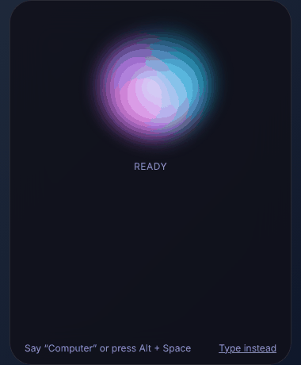
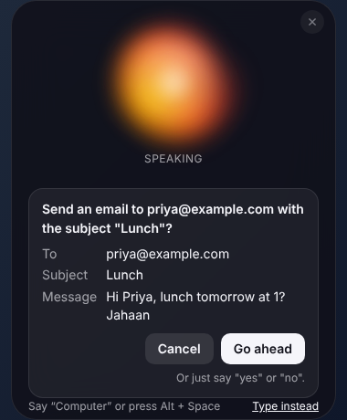
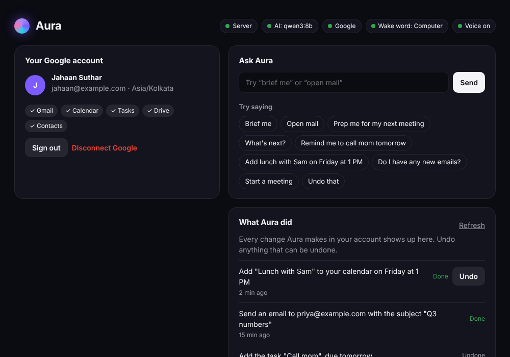

<div align="center">

# Aura

**A free, private voice assistant for your Mac that actually gets things done in your Google account.**

Say the wake word, an orb lights up in the corner of your screen, and Aura reads your inbox, plans your day,
preps you for meetings and opens anything you ask for. The AI runs on your Mac. No subscription, no cloud bill.



[Quick start](#quick-start) · [What it can do](#what-it-can-do) · [How it works](#how-it-works) · [Setup guide](docs/SETUP.md) · [Lessons](#learn-how-its-built)

</div>

---

## Why Aura is different

- **100% free and local by default.** The AI is [Ollama](https://ollama.com) on your Mac, speech-to-text is Whisper on your Mac, and replies use the built-in macOS voice. Your emails never go to an AI company. (You can opt in to Claude with your own API key if you want.)
- **"Brief me."** One sentence gives you your whole day: what's next, what's due, who emailed you, and what's overdue.
- **"Prep me for my next meeting."** Aura pulls together who's coming, the agenda, your latest emails with those people and the related Drive files, in a single spoken answer.
- **"Undo that."** Added the wrong event or task? Undo it by voice or from the activity list.
- **It asks before it sends.** Anything that reaches other people (an email, an invite with guests) shows you exactly what will go out and waits for your "yes".
- **Instant for the common stuff.** "Open mail", "what's next", "join my meeting" and friends skip the AI entirely and answer in milliseconds.
- **The orb tells you what it's touching.** It glows in Gmail's red, Calendar's blue or Drive's green while it works.

<p align="center">
  
  &nbsp;&nbsp;
  
</p>

## What it can do

| Say | What happens |
| --- | --- |
| "Open mail" / "open calendar" / "open drive" | Opens the Google app in your browser, signed in to the right account |
| "Brief me" / "what's my day like" | Your events, unread email and tasks in one answer |
| "Prep me for my next meeting" / "prep me for the roadmap review" | Attendees, agenda, recent emails and related files |
| "Join my meeting" | Opens the Meet link of the meeting happening now or within the hour |
| "Start a new meeting" | Opens a fresh Google Meet |
| "What's next?" / "what's on my calendar tomorrow" | Reads your schedule |
| "Add dentist on Friday at 3 PM" | Creates the event (and can be undone) |
| "Any new emails?" / "what did Priya say about the budget" | Searches and reads Gmail |
| "Email Sam and ask if lunch at 1 works" | Finds Sam in your contacts, drafts the email and asks before sending |
| "Remind me to buy milk" / "I finished the report" | Adds or completes Google Tasks |
| "Find the Q3 deck" | Searches Drive by file name |
| "Undo that" | Reverses the last thing Aura did, when it can |

## Quick start

You need a Mac, [Node 22](https://nodejs.org), [Docker Desktop](https://www.docker.com/products/docker-desktop/) and [Ollama](https://ollama.com). Everything is free.

```bash
git clone https://github.com/TheRealJahaan/Aura-Practice.git aura && cd aura
npm install
npm run build -w packages/shared

npm run db:up                                   # Postgres in Docker on port 5433
cp apps/api/.env.example apps/api/.env          # then fill it in (see docs/SETUP.md)
npm run db:migrate

ollama pull qwen3:8b                            # the free local AI (qwen3:4b on 8 GB Macs)

npm run api                                     # terminal 1: the API on http://127.0.0.1:3000
npm run desktop                                 # terminal 2: the Mac app
```

The first time, the app asks for microphone access and opens your browser to sign in with Google. The full walkthrough, including creating your free Google client and wake word key, is in **[docs/SETUP.md](docs/SETUP.md)**.

No wake word key? Press <kbd>⌥ Option</kbd> + <kbd>Space</kbd> anywhere to talk.

## How it works

```
 You speak ──▶ Wake word (Porcupine, on device) ──▶ Whisper (on device) ──▶ text
                                                                             │
 Mac app (Electron)                                                          ▼
   orb + dashboard ◀── spoken reply (macOS "say") ◀── Aura API (NestJS, on 127.0.0.1)
   opens links                                          │
                                                        ├─ instant commands (no AI)
                                                        ├─ AI agent: Ollama on your Mac (or Claude, opt-in)
                                                        ├─ tools: Gmail, Calendar, Tasks, Drive, Contacts, Meet
                                                        └─ Postgres: your session, conversation and undo history
```

```
apps/
  api/        NestJS + Prisma API: Google sign-in, the tools and the AI agent
  desktop/    Electron Mac app: orb, wake word, speech-to-text, voice, dashboard
  mobile/     Expo app shell (early)
packages/
  shared/     Zod schemas shared by the API and the apps
infra/        Docker Compose for Postgres
docs/         Setup guide and lessons
```

## Security and privacy

- **Google sign-in uses the browser**, never a password box in the app, with the loopback + PKCE flow from [RFC 8252](https://datatracker.ietf.org/doc/html/rfc8252). The app never sees your Google tokens.
- **Your Google refresh token is encrypted** in the database with AES-256-GCM, and session tokens are stored only as hashes.
- **The API only listens on 127.0.0.1**, so nothing else on your network can reach it.
- **The Mac app is locked down**: sandboxed renderer, context isolation, a narrow validated bridge, and its session token encrypted with the macOS Keychain.
- **Aura only opens Google pages.** A link inside an email can't make it open anything else.
- **Email text is treated as data, not instructions**, so a malicious email can't tell the AI what to do, and anything that sends always needs your confirmation.

More in [SECURITY.md](SECURITY.md).

## Checks

```bash
npm run typecheck && npm run lint && npm test   # every workspace
npm run test:e2e -w apps/api                    # API end to end, needs Postgres
npm run test:ui -w apps/desktop                 # the orb and dashboard in a real browser
npm run test:smoke -w apps/desktop              # launches the real Electron app
```

## Learn how it's built

- [Lesson 1: The foundation](docs/lessons/01-foundation.md): the monorepo, Postgres and Prisma, NestJS, shared schemas, tests and CI
- [Lesson 2: How Aura works](docs/lessons/02-how-aura-works.md): sign-in, tools, the agent, undo, the Mac app, voice and the wake word

## Contributing

Ideas and pull requests are welcome. Read [CONTRIBUTING.md](CONTRIBUTING.md) to get started. If Aura saves you time, a ⭐ helps other people find it.

## License

[MIT](LICENSE). Third-party components are listed in [THIRD_PARTY_NOTICES.md](THIRD_PARTY_NOTICES.md).
